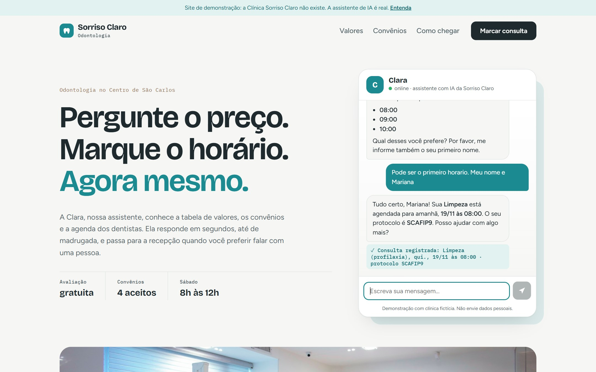
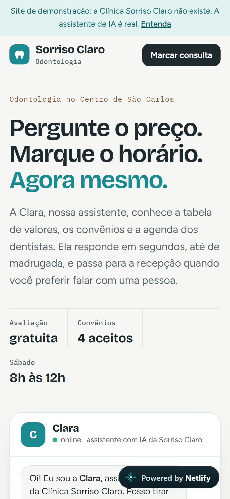
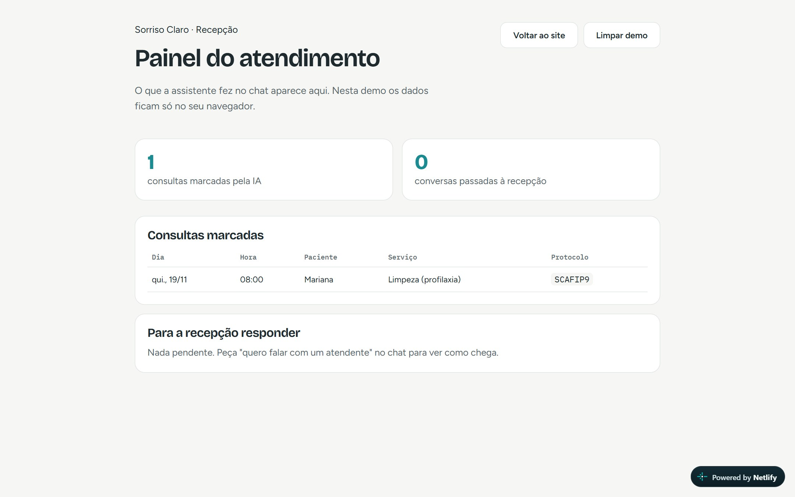

# Clara · assistente de IA para clínicas (demo)

Site de uma clínica odontológica **fictícia** com uma assistente de IA que tira dúvidas sobre preços e convênios, consulta a agenda e marca consultas sozinha.

**Teste ao vivo:** https://clinica-ia-demo-alan.netlify.app



## O que ela faz

- Responde sobre tratamentos, valores, convênios, horários e endereço usando **apenas** os dados cadastrados da clínica. Se não souber, oferece passar para a recepção em vez de inventar.
- Consulta horários livres e agenda a consulta. O horário é **validado no servidor** antes de confirmar, então a IA não consegue marcar em cima de outra consulta.
- Encaminha para um atendente humano quando o paciente pede, reclama ou o assunto foge do roteiro.
- Mostra consultas marcadas e transferências num **painel da recepção** (`/painel`).

## Como funciona

```
Navegador (React)  →  /api/chat (Netlify Function)  →  Google Gemini
                           │
                           ├─ ver_horarios        (agenda gerada e filtrada no servidor)
                           ├─ agendar_consulta    (valida o horário, gera protocolo)
                           └─ transferir_para_recepcao
```

A IA só interpreta a mensagem e redige a resposta. As regras de negócio (horários, preços, validação do agendamento) ficam no código, via *function calling*.

- **Front-end:** React 18 + TypeScript + Vite, CSS próprio, responsivo.
- **Back-end:** Netlify Functions (TypeScript), com limite de mensagens por IP.
- **IA:** Google Gemini via Netlify AI Gateway, com lista de modelos de reserva.
- **Dados da clínica:** `shared/clinica.ts` (trocar esse arquivo adapta a demo para outro negócio).

| Celular | Painel da recepção |
| --- | --- |
|  |  |

## Rodar localmente

```bash
npm install
npx netlify dev
```

Defina `GEMINI_API_KEY` (e opcionalmente `GEMINI_MODEL`) num arquivo `.env` para usar sua própria chave do Google AI Studio.

---

Feito por **Alan Souza**, desenvolvedor full-stack e de IA em São Carlos-SP · [alansouza.netlify.app](https://alansouza.netlify.app)

A Clínica Sorriso Claro não existe. Fotos: Unsplash.
