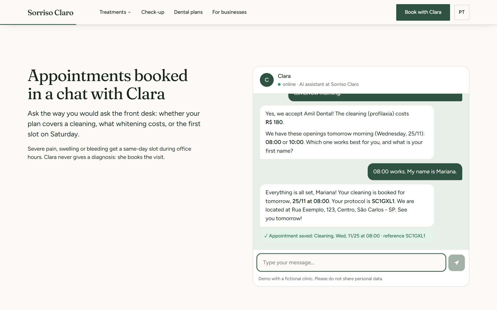
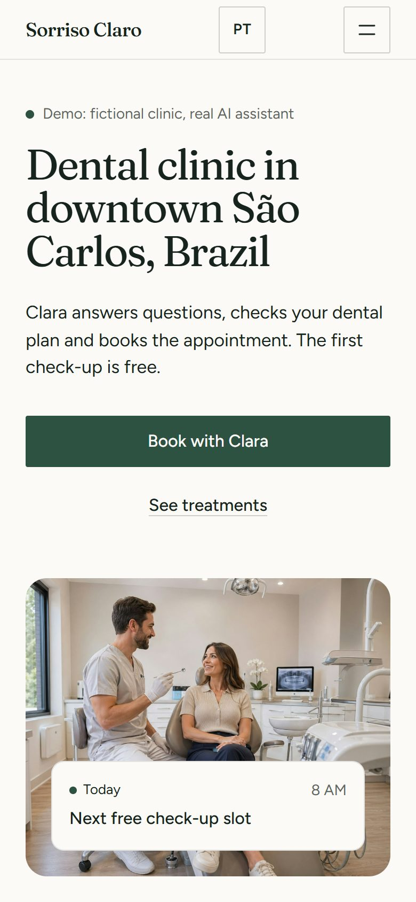
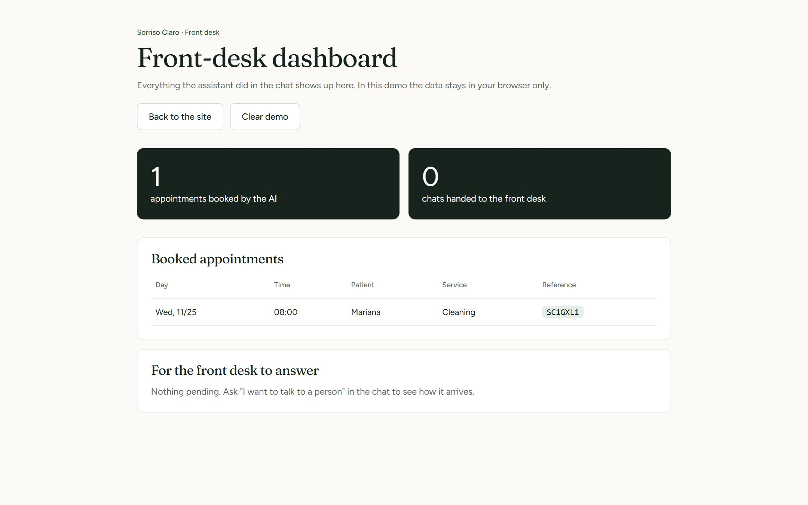

# Clara · AI receptionist for clinics (demo)

**English** · [Português](README.pt-BR.md)

Clara is an AI assistant for a **fictional** dental clinic in Brazil. She answers questions about prices and dental plans, checks the schedule and books appointments on her own, on the website and on WhatsApp.

**Live demo:** https://clinica-ia-demo-alan.vercel.app/?lang=en (the site has an EN / PT switch, and Clara replies in the visitor's language)


## What she does

- Answers about treatments, prices, dental plans, hours and address using **only** the clinic's own data. When she does not know, she offers to hand over to the front desk instead of making something up.
- Checks free slots and books the appointment. Every slot is **validated on the server** before it is confirmed, so the AI cannot double-book.
- Hands the chat to a person when the patient asks for one, complains, or goes off script. She never gives a diagnosis; urgent pain gets the nearest free slot.
- Shows bookings and handovers in a **front-desk dashboard** (`/painel`).
- Runs on **WhatsApp** through Meta's official Cloud API, with the same rules and schedule as the website.



## How it works

```
Website (React)          →  /api/chat      ─┐
WhatsApp (Meta Cloud API) →  /api/whatsapp  ─┴→  shared agent  →  Google Gemini
                                                    │
                                                    ├─ ver_horarios              (free slots, filtered on the server)
                                                    ├─ agendar_consulta          (validates the slot, issues a reference)
                                                    └─ transferir_para_recepcao  (hands over to a person)
```

The model only reads the message and writes the reply. Business rules (hours, prices, booking validation) live in the code and are reached through **function calling**.

- **Front end:** React 18, TypeScript and Vite, hand-written CSS, responsive, bilingual (`src/idioma.ts`).
- **Back end:** TypeScript serverless functions on Vercel, with per-IP and per-number rate limits.
- **AI:** Google Gemini with function calling and a fallback list of models.
- **WhatsApp:** webhook in `shared/whatsapp.ts`.
  - Checks Meta's `X-Hub-Signature-256` signature and answers each message once, even when Meta resends it.
  - Keeps a short chat history per number (optionally in Upstash Redis) and alerts the front desk of each booking or handover.
  - Setup guide (in Portuguese): [WHATSAPP.md](WHATSAPP.md).
- **Clinic data:** `shared/clinica.ts`. Replacing this file adapts the demo to another business.

| Phone | Front-desk dashboard |
| --- | --- |
|  |  |

## Run locally

```bash
npm install
npx vercel dev
```

Set `GEMINI_API_KEY` (and optionally `GEMINI_MODEL`) in a `.env` file to use your own Google AI Studio key. The WhatsApp variables are listed at the top of `shared/whatsapp.ts`.

---

Built by **Alan Souza**, full-stack and AI developer in Brazil · [alansouza.netlify.app](https://alansouza.netlify.app) · [LinkedIn](https://linkedin.com/in/alanvasconi)

Sorriso Claro does not exist. Photos: Unsplash.
