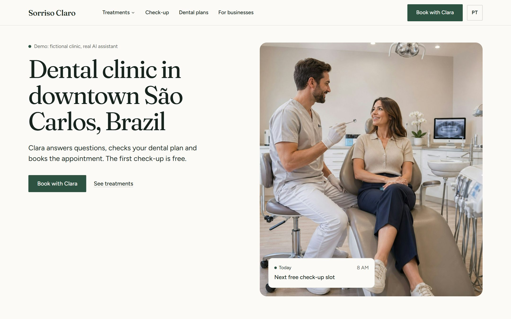
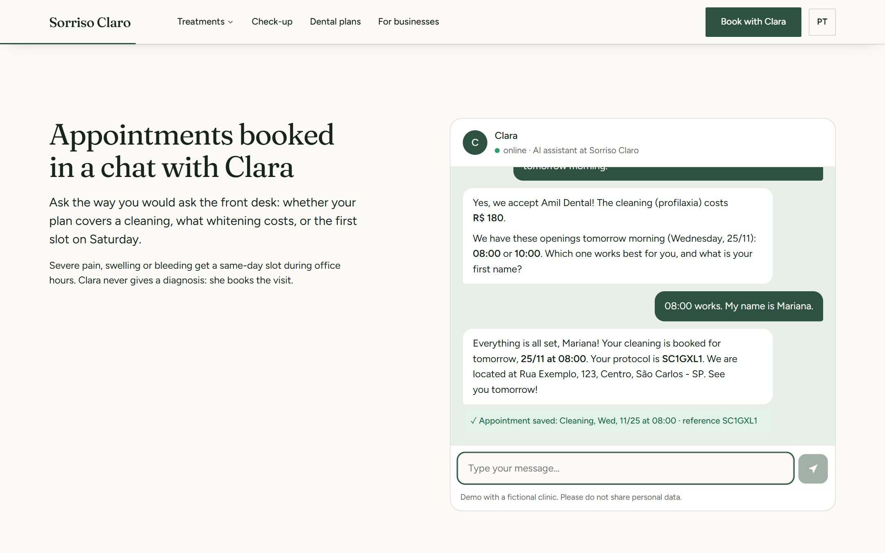
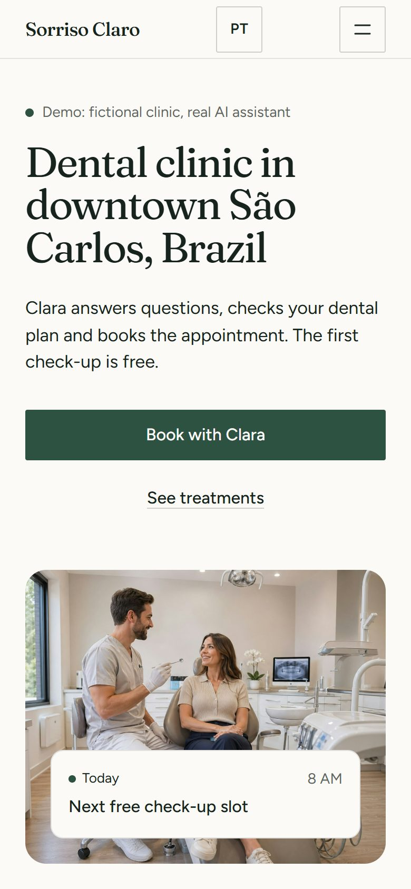
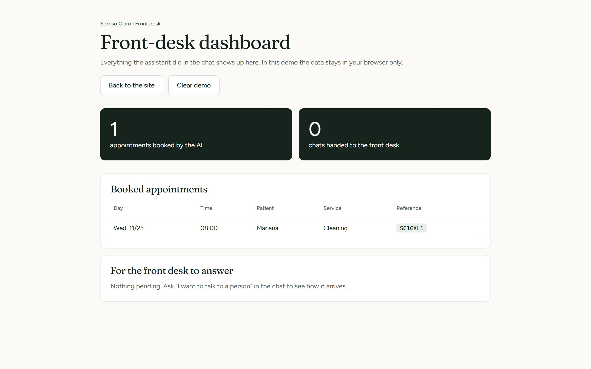

# Clara · assistente de IA para clínicas (demo)

[English](README.md) · **Português**

A Clara é a assistente de IA de uma clínica odontológica **fictícia**. Ela tira dúvidas sobre preços e convênios, consulta a agenda e marca consultas sozinha, no site e no WhatsApp.

**Teste ao vivo:** https://clinica-ia-demo-alan.vercel.app (o site tem troca PT / EN, e a Clara responde no idioma de quem escreve)



## O que ela faz

- Responde sobre tratamentos, valores, convênios, horários e endereço usando **apenas** os dados cadastrados da clínica. Se não souber, oferece passar para a recepção em vez de inventar.
- Consulta horários livres e agenda a consulta. O horário é **validado no servidor** antes de confirmar, então a IA não consegue marcar em cima de outra consulta.
- Encaminha para um atendente humano quando o paciente pede, reclama ou o assunto foge do roteiro. Não dá diagnóstico; dor forte ganha o horário livre mais próximo.
- Mostra consultas marcadas e transferências num **painel da recepção** (`/painel`).
- Atende no **WhatsApp** pela API oficial da Meta, com as mesmas regras e a mesma agenda do site.



## Como funciona

```
Site (React)               →  /api/chat      ─┐
WhatsApp (API da Meta)     →  /api/whatsapp  ─┴→  agente compartilhado  →  Google Gemini
                                                      │
                                                      ├─ ver_horarios              (agenda filtrada no servidor)
                                                      ├─ agendar_consulta          (valida o horário, gera protocolo)
                                                      └─ transferir_para_recepcao  (passa para uma pessoa)
```

A IA só interpreta a mensagem e redige a resposta. As regras de negócio (horários, preços, validação do agendamento) ficam no código, via *function calling*.

- **Front-end:** React 18, TypeScript e Vite, CSS próprio, responsivo e bilíngue (`src/idioma.ts`).
- **Back-end:** funções serverless em TypeScript no Vercel, com limite de mensagens por IP e por número.
- **IA:** Google Gemini com function calling e lista de modelos de reserva.
- **WhatsApp:** webhook em `shared/whatsapp.ts`.
  - Confere a assinatura da Meta e responde cada mensagem uma vez só.
  - Guarda o histórico curto de cada número (opcionalmente no Upstash Redis) e avisa a recepção de agendamentos e transferências.
  - Passo a passo da configuração: [WHATSAPP.md](WHATSAPP.md).
- **Dados da clínica:** `shared/clinica.ts`. Trocar esse arquivo adapta a demo para outro negócio.

| Celular | Painel da recepção |
| --- | --- |
|  |  |

## Rodar localmente

```bash
npm install
npx vercel dev
```

Defina `GEMINI_API_KEY` (e opcionalmente `GEMINI_MODEL`) num arquivo `.env` para usar sua própria chave do Google AI Studio. As variáveis do WhatsApp estão listadas no topo de `shared/whatsapp.ts`.

---

Feito por **Alan Souza**, desenvolvedor full-stack e de IA em São Carlos-SP · [alansouza.netlify.app](https://alansouza.netlify.app)

A Clínica Sorriso Claro não existe. Fotos: Unsplash.
